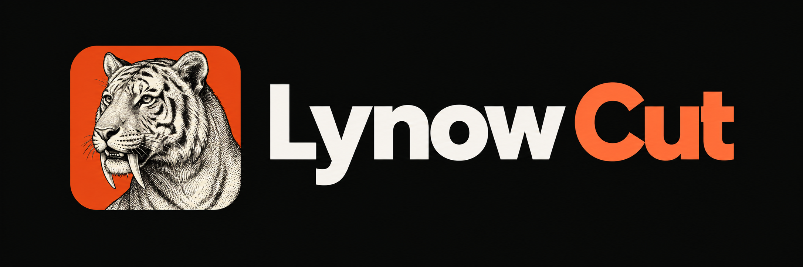
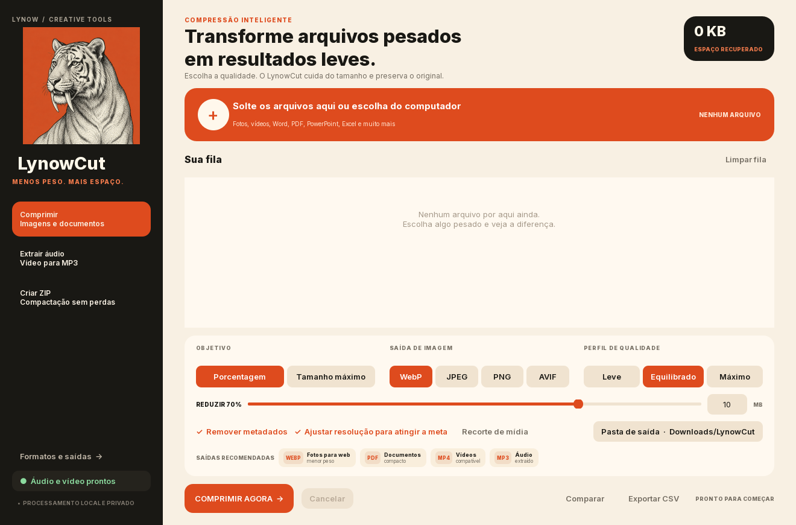
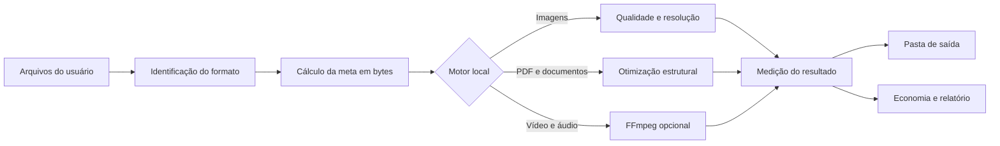

<p align="center"></p>

<p align="center"><sub>LynowCut</sub></p>

---

<p align="center">
  
</p>

<p align="center">
  Escolha quanto o arquivo precisa pesar. O LynowCut cuida do resto — sem mandar nada para a nuvem.
</p>

<p align="center">
  <a href="https://github.com/arthurlynow098/LynowCut/releases"></a>
  
  
</p>

> [!IMPORTANT]
> O pacote completo para Windows está disponível em **[Releases](https://github.com/arthurlynow098/LynowCut/releases)**. Extraia todo o ZIP antes de abrir o programa. Os binários não ficam dentro do histórico do repositório.

## Sobre o projeto

Todo mundo já passou por isso, o PDF não cabe no e-mail, o vídeo ficou pesado demais ou uma pasta de imagens ocupa muito mais espaço do que deveria. O LynowCut nasceu para resolver esse momento sem transformar uma tarefa simples em uma sequência de sites, conversores e configurações confusas.

Você escolhe quanto quer reduzir ou informa o tamanho máximo. O programa procura o melhor resultado possível, mostra quanto espaço foi recuperado e salva uma nova cópia. Tudo acontece no seu computador: sem conta, sem nuvem, sem anúncios e sem mexer no arquivo original.

<p align="center">
  
</p>

## Principais recursos

| Recurso | Como funciona |
|---|---|
| Meta por porcentagem | Você escolhe quanto quer reduzir; o LynowCut equilibra qualidade, resolução e tamanho. |
| Tamanho máximo | Precisa caber em um anexo de 10 MB? Informe o limite e deixe o programa trabalhar nessa meta. |
| Imagens otimizadas | Reduza fotos, artes e capturas ou converta para formatos modernos como WebP e AVIF. |
| PDFs e documentos | Deixe apresentações, planilhas, arquivos do Word e PDFs mais fáceis de guardar e compartilhar. |
| Vídeo e áudio | Comprima vídeos ou guarde apenas o áudio quando a imagem não for necessária. |
| Privacidade local | Seus arquivos continuam no seu computador e os originais nunca são substituídos. |
| Organização da saída | Escolha onde salvar; o programa evita nomes repetidos e mantém cada resultado organizado. |
| Relatório e comparação | Veja o antes e depois, confira o espaço recuperado e exporte um resumo em CSV. |

## Tecnologias

<p>
  
  
  
  
  
  
  
  
</p>

### Aplicação desktop

- **Python 3.12** para a aplicação e o motor de processamento;
- **PySide6 / Qt 6** para a interface nativa do Windows;
- **PyInstaller** para gerar a distribuição `win-x64`;
- interface com fila, estados de processamento, cancelamento e pasta de saída;
- publicação portátil: extraia o pacote e abra `LynowCut.exe`.

### Imagens, PDFs e documentos

- **Pillow** para leitura, conversão, redimensionamento e compressão de imagens;
- **pillow-heif** para HEIC e HEIF quando o codec está disponível;
- **pikepdf** para otimização estrutural de PDFs;
- **pypdfium2** para a redução visual de PDFs fotográficos em metas agressivas;
- recompressão de imagens incorporadas em documentos baseados em ZIP, como DOCX, PPTX e XLSX.

### Vídeo e áudio

- **FFmpeg** e **ffprobe** instalados opcionalmente pela própria interface;
- conversão de vídeos compatíveis para MP4 com H.264 e AAC;
- extração de áudio para MP3;
- suporte a recorte por início e duração;
- medição do resultado final antes de confirmar a meta atingida.

## Arquitetura



A interface envia cada item da fila para o motor local com uma meta calculada. O processador escolhe a estratégia adequada ao formato, mede o arquivo produzido e informa se a meta foi atingida. O original permanece intacto durante todo o fluxo.

## Experiência no Windows

O LynowCut tenta falar a língua de quem só precisa resolver o arquivo. A fila mostra o que entrou, o que saiu e quanto espaço foi economizado. Formato, qualidade e destino ficam visíveis, enquanto opções mais avançadas aparecem somente quando realmente ajudam.

## Fluxo de uso

1. Baixe o pacote para Windows em **[Releases](https://github.com/arthurlynow098/LynowCut/releases)**.
2. Extraia todo o conteúdo de `LynowCut-Windows-x64.zip`.
3. Abra `LynowCut.exe` e adicione os arquivos à fila.
4. Escolha entre redução por porcentagem ou tamanho máximo.
5. Defina o formato de imagem, a qualidade mínima e a pasta de saída.
6. Clique em **Comprimir agora** e acompanhe o resultado de cada arquivo.
7. Para vídeos e extração de áudio, ative os recursos de mídia pela lateral do aplicativo.

O pacote principal não inclui o FFmpeg para manter o download menor. Quando o usuário ativa áudio e vídeo, o LynowCut baixa os componentes necessários, valida o arquivo recebido e os mantém ao lado da aplicação.

## Estrutura do repositório

```text
LynowCut/
├── lynowcut/
│   ├── app.py                       Interface PySide6
│   └── engine.py                    Motor local de processamento
├── tests/
│   └── test_engine.py               Testes de imagens, PDFs, documentos e ZIP
├── assets/
│   ├── fonts/                       Fonte e licença tipográfica
│   ├── lynowcut.ico                 Ícone do aplicativo
│   └── mascot-ui.png                Identidade visual do tigre
├── site/dist/                       Landing page do LynowCut
├── .github/workflows/               Build e publicação de Releases
├── LynowCut.spec                    Configuração do PyInstaller
├── requirements.txt                 Dependências da aplicação
├── requirements-build.txt           Dependências de distribuição
└── LEIA-ME-PRIMEIRO.md              Guia completo do projeto
```

## Executando o código

### Windows

Requisitos: Windows 10 ou mais recente e Python 3.12.

```powershell
py -3.12 -m venv .venv
.\.venv\Scripts\python.exe -m pip install -r requirements.txt
.\.venv\Scripts\python.exe main.py
```

Também é possível executar `INICIAR.bat`, que prepara o ambiente e abre o aplicativo sem manter um console visível.

### Testes e distribuição

```powershell
.\.venv\Scripts\python.exe -m pip install -r requirements-build.txt
.\.venv\Scripts\python.exe -m unittest discover -s tests -v
.\.venv\Scripts\python.exe -m PyInstaller --noconfirm --clean LynowCut.spec
```

O resultado será criado em `dist\LynowCut`. A pasta `_internal` deve ser distribuída junto de `LynowCut.exe`.

## Decisões técnicas

- **Processamento local:** mantém os arquivos no computador e evita depender de serviços externos.
- **Originais preservados:** nenhum processamento substitui silenciosamente o arquivo fornecido pelo usuário.
- **Meta mensurável:** cada operação compara o resultado em bytes com o objetivo informado.
- **Qualidade com limite:** imagens procuram a melhor qualidade possível sem ultrapassar a meta, com redimensionamento proporcional opcional.
- **FFmpeg sob demanda:** reduz o tamanho inicial do aplicativo e ativa mídia somente para quem precisa.
- **PDF adaptativo:** tenta primeiro a otimização estrutural e usa uma versão visual apenas quando a meta agressiva exige essa alternativa.
- **Build reproduzível:** testes e empacotamento são executados automaticamente pelo GitHub Actions antes de publicar uma Release.

## Estado atual

Esta é a versão **0.1.0 alpha**. Compressão de imagens, PDFs, documentos, ZIP, vídeo e áudio está implementada, junto da fila, cancelamento, comparação e relatório. O suporte de vídeo depende da instalação opcional do FFmpeg.

Alguns formatos já chegam fortemente compactados e podem apresentar pouco ganho. Em PDFs fotográficos, uma meta agressiva pode converter as páginas em conteúdo visual, preservando a aparência, mas removendo recursos como texto pesquisável, links e formulários. O aplicativo informa esse comportamento no resultado.

O executável Windows ainda não possui assinatura Authenticode comercial. Em máquinas que ainda não reconhecem o editor, o Windows pode exibir um aviso de reputação. As Releases são produzidas automaticamente a partir do código versionado neste repositório.

## Documentação

- [Guia completo do projeto](LEIA-ME-PRIMEIRO.md)
- [Direção do produto](PRODUTO.md)
- [Motor de processamento](lynowcut/engine.py)
- [Testes automatizados](tests/test_engine.py)
- [Landing page](site/dist/index.html)
- [Automação de Releases](.github/workflows/release.yml)

## Licença

Distribuído sob a [licença MIT](LICENSE). A fonte Inter usada pela interface mantém sua licença no diretório [`assets/fonts`](assets/fonts).

---

<p align="center"><sub>Estudo · construção · evolução</sub><br><a href="https://github.com/arthurlynow098">Perfil</a> · <a href="https://arthurentsev.vercel.app/">Portfólio</a></p>
